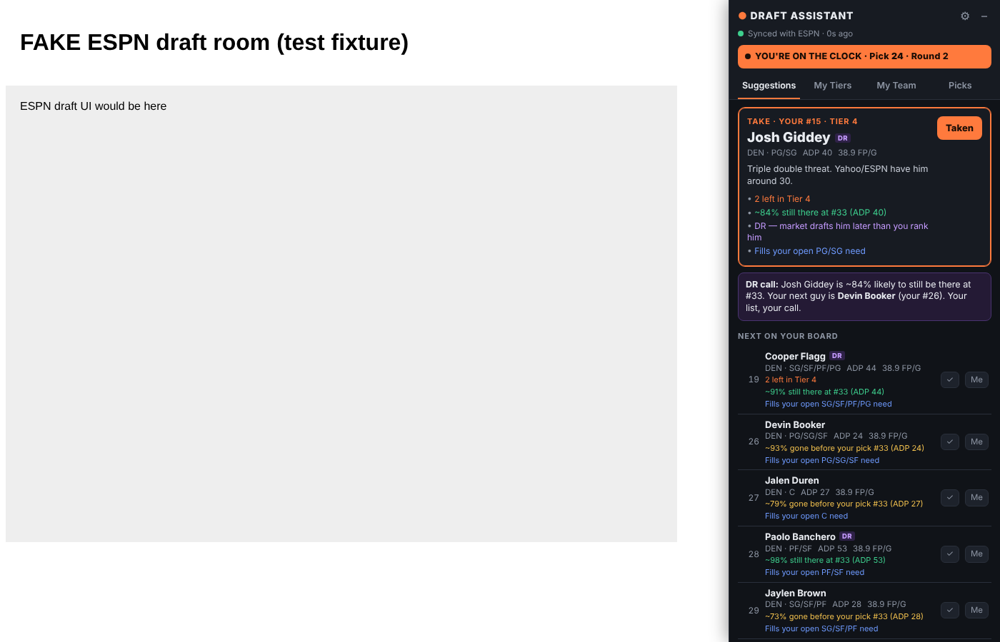

# Hoops Draft Assistant

> **Also in this repo: [Hardwood Wire](web/README.md)**, a personal NBA news, highlights, injuries, scores, stats and fantasy web app (`web/`). Run it with `cd web && npm install && npm run dev`. The draft extension below is unchanged.

Your own fantasy basketball tier list, live inside the ESPN draft room. It works like the FantasyPros Draft Assistant panel, but your list drives every suggestion.



- **Your order is law.** The top suggestion is always the highest-ranked player on *your* board who's still available. Nothing reorders your list.
- **Syncs with ESPN automatically.** Works in mock and real drafts. It reads picks, teams, draft order, roster slots and scoring from ESPN's own draft-room requests (with your existing ESPN login) every ~3 seconds. Drafted players get crossed off and your picks go to My Team.
- **Your spreadsheet is built in.** your list as edited in the extension (Oct 14) plus Aday Mara and Bennett Stirtz: 180 players across 12 tiers. `*` = injury prone, `DR` = don't reach (the market drafts him later, but you like him there). Tiers and notes come from your tier sheet.
- **Context, not overrides.** Each player shows notes for the last player left in a tier, the chance he's gone before your next pick (from ESPN ADP), open-slot needs, and ESPN injury status. DR players get a badge and a plain note ("you like him here; market ADP 40"). DR never changes the order or suggests someone else.

## Install (2 minutes, Chrome / Edge / Brave)

1. Download this repo (Code → Download ZIP) and unzip it.
2. Open `chrome://extensions` and turn on **Developer mode** (top right).
3. Click **Load unpacked** and pick the `extension/` folder.
4. Open any ESPN fantasy **basketball** draft room. The panel docks on the right.
   - **Alt+Shift+D** hides or shows it.
   - ⚙ opens rankings & settings.

To practice, start an ESPN mock draft (fantasy.espn.com → Basketball → Mock Draft Lobby) and watch the panel follow along.

## Team fit: balance, age, health

Your list order never changes, but the panel also checks every pick against your roster:

- **Position balance:** guards / forwards / centers vs. full-roster targets (default 5 / 5 / 3 for 13 rounds). Multi-position players count partly toward each group.
- **Age:** players 35+. Taking a third one is flagged (adjustable). Ages come from ESPN's athlete records, with built-in birth dates for veterans as a backup.
- **Health:** too many injury-prone (`*`) players, or ESPN listing a player OUT.
- **Open starting slots** you still have to fill.

When your #1 available would hurt the team, the Suggestions tab shows a red **⚠ Avoid** box explaining why, plus a green **Draft instead** card with the best-fitting player from the next ~12 on your list. My Tiers shows chips like `Too many F`, `Need C`, `Age 41: 2 vets` on every available player. The thresholds are in ⚙ → *Team balance & health*.


## Plan, injury risk, and drafting from the panel

- **Plan tab:** a pick-by-pick plan for every remaining pick (your slot is #4: picks 4, 25, 32, 53, 60, 81, 88, 109, 116, 137, 144, 165, 172). At each pick it takes the best team fit from your list among players at least 50% likely to still be there (1,000 simulated drafts), shows 2 alternates, and ends with the projected team balance. It re-plans after every pick.
- **Injury risk:** each player is low / medium / high from your `*`, games played last season (ESPN), age, and ESPN's current status. Your team has a cap on risky players (default 3, in ⚙).
- **Draft / Queue buttons:** on the clock, **Draft** (tap twice) clicks ESPN's own DRAFT button for that player, using ESPN's player search if he isn't on screen. Otherwise **Queue** adds him to your ESPN queue, so autopick takes him if your clock runs out. If ESPN's page can't be matched, the name is left in ESPN's search box for you to click.

## Before draft day: connect your league

⚙ → **My ESPN league** comes prefilled with your league (888634487). It's private, so log in at fantasy.espn.com in the same browser first.

1. Click **Test connection**. It shows your league name, draft date and time, and the scoring ESPN has on file, and checks that scoring against your tier sheet.
2. Pick your team from the dropdown. Once ESPN randomizes the draft order, the test shows **your slot and every pick number** you'll have. Inside the draft room your slot is detected automatically either way.

**Drafting on your phone?** In the extension popup, **Follow my ESPN draft** opens a full-page board on your laptop that follows league 888634487 live. Anything you mark there is shared with the draft-room panel.

## Panel tabs

| Tab | What it does |
| --- | --- |
| **Suggestions** | Who to take now (your top available player), the DR call, your next 5, and who's probably still there at your next pick |
| **Plan** | Your pick-by-pick plan for the rest of the draft (see above). |
| **My Tiers** | Your full board by tier, with each available player's **chance of still being there at your next 3 picks**. It comes from 2,000 simulations of the rest of the draft from the current board, using ESPN ADP, and recalculates after every pick. with drafted players crossed off, your picks in blue, and a "left in tier" meter. Fully drafted tiers fold away. Type a name and press Enter to mark him drafted. |
| **My Team** | Your roster, which starting slots are still empty, position counts, and projected FP/G in your scoring |
| **Picks** | Every pick so far with team names. Undo and "Me" fix-ups. |

## If ESPN sync doesn't work

The header shows the sync state, and the panel falls back in this order:

1. **ESPN API** (green): exact picks.
2. **Reading the page** (yellow): if ESPN won't serve the league data (some mock rooms, outages), it reads drafted names from the page's pick and roster widgets. This is best effort, because ESPN can change its page.
3. **Manual**: ✓ marks a player drafted, **Me** marks him yours, and Enter in the search box marks the first match. The popup also opens a full-page **manual draft board** for Yahoo, Sleeper or in-person drafts.

## Editing your rankings (pre-draft and mid-draft)

In the panel, open **My Tiers → ✎ Edit list**, or click the toolbar icon → **Edit my rankings** to edit before the draft. Changes save instantly and update suggestions, odds and the plan right away:

- **Drag** a row (⠇) to a new spot, or onto a tier header to make him the first player of that tier.
- **Type a rank:** click a player's rank number, type the new rank, and press Enter.
- **▲ / ▼** move one spot. **T↑ / T↓** move to the tier above or below. **✂** starts a new tier at that player. A tier header's **merge ↑** joins it with the tier above, and **✎** renames it.
- **DR / INJ\*** toggles the flags. **✕** removes a player.
- **Add a player:** search his name. Players not on your list get **+ Next** (becomes your next suggestion) and **+ End**.
- **↶ Undo** goes back step by step. **Restore built-in board** returns to the built-in board.
- **Add player box** (in the edit bar): type a name, optionally a rank ("at #"), then **+ Add** or click an ESPN match.
- **Player info in edit mode:** **ADP** (ESPN; or your tier sheet's market rank if ESPN isn't loaded), **Last** = 2025-26 fantasy points per game in your scoring (with games played), **Proj** = ESPN's projection for this season in your scoring. The edit page loads ESPN data for your league even when no draft is running.

Mid-draft, tick **Hide drafted** first so only live players are on screen.

## Changing your rankings

⚙ → *Import or replace your list*. You can paste straight from Excel or Google Sheets (name column, plus the DR column), a CSV, or text with `Tier N` lines. If the pasted list has no tiers, your current tier breaks are kept by rank position. **Restore built-in board** brings back the built-in board. To update the built-in board from a new spreadsheet version, run `python3 scripts/build_rankings.py "Ranking 10.xlsx" "Ranking 10"`. It keeps the spreadsheet order exactly, applies the tier breaks by rank, carries notes over by player, and rewrites [`data/omar-rankings.csv`](data/omar-rankings.csv) and `extension/data/default-rankings.js`.

## ESPN's pre-draft rankings (autopick)

The extension **only reads** from ESPN. It doesn't edit ESPN's pre-draft list, because ESPN has no published API for that and changing your league data behind your back isn't safe. If you want autopick to follow your board, use ⚙ → **Copy as text** and drag the first few rounds into place in ESPN's *Pre-Draft Rankings* editor.

## Development

```
extension/
  core/      pure logic (no DOM): names, rankings parser, scoring, ESPN parsers, draft engine, page scan
  data/      default-rankings.js (generated from data/omar-rankings.csv)
  ui/app.js  panel controller + renderer (shadow DOM)
  content/   ESPN draft-room bootstrap + sync loop
  options/ popup/ standalone/
tests/       node:test unit tests + Playwright e2e against a fake ESPN draft room
```

- `npm test`: unit tests for parsing, matching, snake math, roster matching, availability model, suggestions, ESPN response parsing, and the default board order.
- `NODE_PATH=$(npm root -g) node tests/e2e/espn-draft-room.e2e.js`: loads the real extension in Chromium against a mocked ESPN draft room and API.

**Known limits.** ESPN's read API is undocumented, so the parsers are defensive and the panel degrades instead of breaking. Page-reading has only been tested against the mock page, not ESPN's real markup. Availability percentages are estimates from a normal spread around ESPN ADP.
